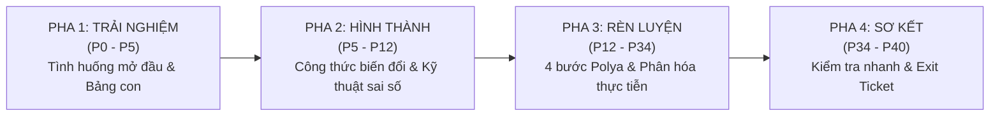
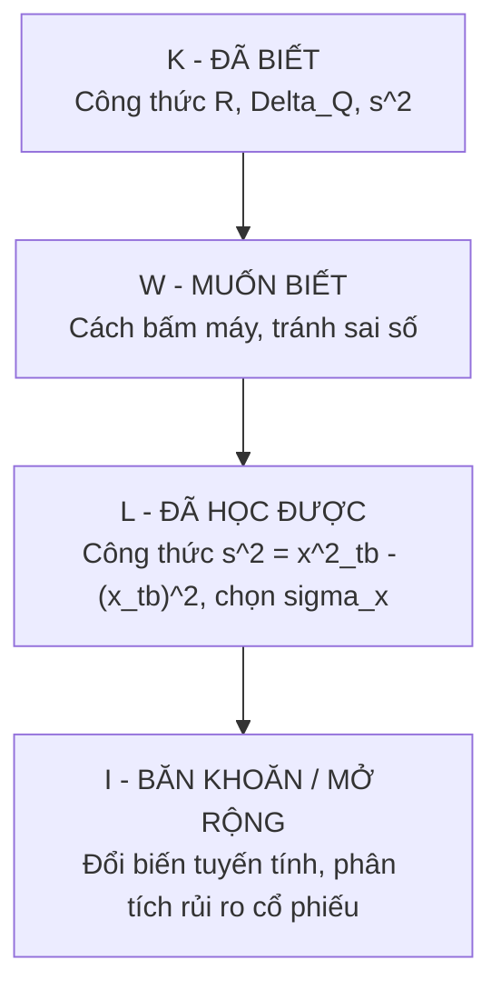

<!-- Nguồn: Firestore lessonPlans/315100a6-dfab-40ef-9d03-aa13df0d5f78 — "Tiết 2: Luyện tập" — bài tương tác adaptive-1792833650874 — tải 2026-10-28 (trích từ dump tasks/tmp-giaoan-dump-12-11-79.json) — số ký tự thân giáo án: 31187 -->

# KẾ HOẠCH DẠY HỌC — CÁC SỐ ĐẶC TRƯNG ĐO MỨC ĐỘ PHÂN TÁN CỦA MẪU SỐ LIỆU GHÉP NHÓM (Tiết 2: Luyện tập)

| Lớp | 12A1 | Tên bài học | Các số đặc trưng đo mức độ phân tán của mẫu số liệu ghép nhóm — Tiết 2: Luyện tập | Môn học | Toán |
|---|---|---|---|---|---|
| Giáo viên | Nguyễn Văn A | Tuần học | 11 | Năm học | 2024 – 2025 |

## I. THÔNG TIN CHUNG

**1. Tiêu chuẩn năng lực cốt lõi**

- Năng lực tư duy và lập luận toán học: So sánh mức độ phân tán của hai mẫu số liệu thực tiễn thông qua các số đặc trưng; giải thích ý nghĩa thực tiễn của độ lệch chuẩn đối với tính ổn định và mức độ rủi ro.
- Năng lực mô hình hóa toán học: Chuyển đổi dữ liệu thống kê từ bối cảnh kiểm soát chất lượng công nghiệp và quan trắc môi trường sang bảng phân bố tần số ghép nhóm để xử lý định lượng.
- Năng lực giải quyết vấn đề toán học: Thực hiện đầy đủ 4 bước Polya để giải quyết bài toán thống kê; lựa chọn linh hoạt giữa công thức định nghĩa và công thức rút gọn của phương sai nhằm tối ưu hóa tính toán và kiểm soát triệt để sai số làm tròn.
- Năng lực sử dụng công cụ, phương tiện học toán: Sử dụng thành thạo máy tính cầm tay (Casio fx-580VN X, fx-880BTG) để kiểm tra các chỉ số thống kê một biến ($s, s^2, Q_1, Q_3$), phân biệt chính xác ký hiệu $\sigma_x$ và $s_x$.

**2. Mục tiêu học tập**

Sau tiết học, học sinh có thể:

| Mức độ | Mục tiêu |
|---|---|
| Must (Cơ bản) | Tính đúng khoảng biến thiên $R$, khoảng tứ phân vị $\Delta_Q$, phương sai $s^2$ và độ lệch chuẩn $s$ của mẫu số liệu ghép nhóm. [Bloom: Nhớ – Hiểu] |
| Should (Trọng tâm) | So sánh được độ đồng đều của hai tập dữ liệu ghép nhóm có cùng đơn vị đo; nhận diện và khắc phục lỗi sai số làm tròn sớm khi tính phương sai; thao tác chuẩn xác chức năng Thống kê trên Casio. [Bloom: Áp dụng] |
| Could (Nâng cao) | Phân tích tác động của phép biến đổi tuyến tính $y = ax + b$ lên các số đặc trưng đo mức độ phân tán; giải được bài toán tìm ẩn số tần số khi biết phương sai. [Bloom: Phân tích – Vận dụng cao] |

**3. Phân hóa mục tiêu**

| Mức Trung bình | Mức Khá | Mức Giỏi |
|---|---|---|
| Hoàn thành bài tập tính $R, \Delta_Q, s^2, s$ từ bảng có sẵn giá trị đại diện; làm theo lộ trình hỗ trợ từng bước. | Hoàn thành so sánh độ phân tán giữa hai mẫu dữ liệu thực tiễn; tự kiểm soát sai số làm tròn bằng công thức rút gọn và bộ nhớ máy tính. | Hoàn thành bài toán mở rộng: chứng minh tính chất của $s^2, s$ qua phép biến đổi tuyến tính; giải phương trình tìm ẩn số tần số $x$. |

**4. Thuật ngữ bài học**

- *Khoảng biến thiên ($R$)*: Hiệu số giữa đầu mút phải của nhóm cuối cùng và đầu mút trái của nhóm đầu tiên.
- *Khoảng tứ phân vị ($\Delta_Q$)*: Hiệu số $\Delta_Q = Q_3 - Q_1$, đại diện cho độ phân tán của $50\%$ số liệu trung tâm.
- *Phương sai biến đổi ($s^2 = \overline{x^2} - (\overline{x})^2$)*: Công thức rút gọn của phương sai giúp tính toán nhanh qua tổng bình phương giá trị đại diện và bình phương số trung bình, tránh việc phải trừ hiệu từng nhóm.
- *Ẩn số tần số*: Tần số chưa biết (kí hiệu là $x$) của một nhóm số liệu cần tìm thông qua hệ thức phương sai đã cho.

**5. Tài liệu và thiết bị dạy học**

- SGK Toán 12 (Tập 1, Kết nối tri thức với cuộc sống, tr. 75 – 80).
- Máy tính cầm tay Casio fx-580VN X hoặc fx-880BTG.
- Bảng con, bút dạ lông bảng cho từng học sinh.
- Phiếu học tập: Phiếu số 1 (Tính toán và kiểm soát sai số); Phiếu số 2 (Mô hình hóa dữ liệu môi trường và sản xuất).

**Căn cứ điều chỉnh từ đánh giá tiết trước:**

- Tiết 1 ghi nhận khoảng $30\%$ học sinh nhầm lẫn giữa độ lệch chuẩn mẫu hiệu chỉnh ($s_x$) và độ lệch chuẩn của mẫu ghép nhóm ($\sigma_x$) khi bấm Casio $\rightarrow$ Bổ sung đối chiếu tường minh ở Pha 2 và Pha 3.
- Gần $25\%$ học sinh làm tròn số trung bình $\overline{x}$ quá sớm (chỉ lấy 1 chữ số thập phân) dẫn đến sai số dây chuyền ở phương sai $s^2 \rightarrow$ Hình thành quy tắc dùng công thức biến đổi $\overline{x^2} - (\overline{x})^2$ và lưu biến nhớ `STO A`.

## BẢNG MINH CHỨNG TIÊU CHUẨN SƯ PHẠM (HQT / CIS / DANIELSON)

| Minh chứng | HS làm gì $\rightarrow$ GV thu được gì | Observer nhìn thấy gì (CIS dự giờ) | Vị trí |
|---|---|---|---|
| **[PHÂN HÓA]** | HS làm việc theo 3 mức nhiệm vụ trên Phiếu học tập số 1 $\rightarrow$ GV thu được phiếu bài làm tương ứng với năng lực. | HS cầm các phiếu phân hóa (xanh: TB, vàng: Khá, cam: Giỏi); GV tiếp cận hỗ trợ có trọng tâm. | Pha 3 (P22–P34) |
| **[ĐGTX]** | HS viết đáp án lên bảng con và đồng loạt giơ theo khẩu lệnh $\rightarrow$ GV đo lường tỉ lệ đúng/sai tức thời. | 100% HS giơ bảng con sau tiếng đếm; GV quét radar nhanh và mời HS giải thích lập luận. | Pha 1 (P0–P5), Pha 4 (P34–P37) |
| **[CÔNG DÂN SỐ]** | HS đối chiếu kết quả tính tay với máy tính Casio $\rightarrow$ GV thu được bảng đối chiếu và giải thích sai số thuật toán. | HS thao tác trên máy tính, so sánh giá trị $\sigma_x$ và $s_x$ trên màn hình với kết quả tự tính. | Pha 3 (P28–P31) |
| **[CÔNG DÂN TOÀN CẦU]** | HS phân tích dữ liệu nồng độ bụi mịn PM2.5 tại hai đô thị $\rightarrow$ GV thu được lập luận toán học về tiêu chuẩn WHO. | Bảng số liệu ô nhiễm quốc tế chiếu trên màn hình; HS thảo luận về mức độ dao động nồng độ bụi mịn. | Pha 3 (P22–P28) |
| Danielson 1a | Khái quát công thức tính phương sai qua hai cách: công thức định nghĩa và công thức rút gọn có kiểm soát sai số. | Bảng phụ và bảng phấn thể hiện rõ hai công thức kèm minh họa trực quan. | Pha 2 (P5–P12) |
| Danielson 1b | Cung cấp bậc thang hỗ trợ (scaffolding) với 2 lộ trình gợi ý cho bài toán chữa chung. | Nhóm TB dùng bộ câu hỏi dắt tay; nhóm Khá–Giỏi dùng bộ câu hỏi định hướng mở. | Pha 3 (P12–P22) |
| Danielson 1c | Công bố mục tiêu Must – Should – Could đầu tiết, HS tự đối soát mức độ hoàn thành ở cuối tiết. | Khung mục tiêu hiển thị trên màn hình; HS tự đánh giá vào phiếu Exit Ticket ở cuối giờ. | Pha 2 (P5–P7), Pha 4 (P37–P40) |
| Danielson 1d | Sử dụng kết hợp bảng con, máy tính Casio, phiếu học tập màu và phần mềm trình chiếu. | Bàn học trang bị đầy đủ bảng con cá nhân, folder tài liệu 3 màu và máy tính cầm tay. | Toàn tiết (P0–P40) |
| Danielson 1e | Tiến trình bài học phân bổ chặt chẽ từ P0 đến P40, các mốc thời gian liền mạch, không có thời gian chết. | Đồng hồ bấm giờ đếm ngược hiển thị trên màn hình máy chiếu cho từng hoạt động cụ thể. | Toàn tiết (P0–P40) |
| Danielson 1f | Phản hồi tức thì các lỗi sai kỹ thuật thông qua hoạt động "Vinh danh lỗi sai" giấu tên. | GV chiếu một bài làm có lỗi làm tròn sớm đưa lên màn hình để cả lớp cùng phân tích. | Pha 3 (P18–P20) |

---

## II. TIẾN TRÌNH DẠY HỌC (4 PHA — 40 PHÚT)



---

### PHA 1: TRẢI NGHIỆM — KHỞI ĐỘNG VÀ ĐẶT VẤN ĐỀ (5 phút, P0–P5)

| Thời gian | Hoạt động của Giáo viên và Học sinh | Nội dung ghi bảng |
|---|---|---|
| P0–P5 | **GV nêu bối cảnh thực tiễn:** Hai phân xưởng may xuất khẩu cùng sản xuất một mã hàng, có năng suất trung bình như nhau ($\overline{x}_1 = \overline{x}_2 = 50$ sản phẩm/ngày). Tuy nhiên, đơn hàng yêu cầu tính đồng đều nghiêm ngặt để giao hàng đúng hẹn.<br/>**[CÂU HỎI THIẾT YẾU]** *"Khi hai tập dữ liệu có cùng số trung bình, làm thế nào để định lượng và khẳng định tập nào có độ đồng đều và tính ổn định cao hơn?"*<br/><br/>**HS giơ BẢNG CON ôn tập 3 câu hỏi kiến thức nền:**<br/>- **Câu 1 [Ghi nhớ]:** Viết công thức tính giá trị đại diện $c_i$ của nhóm $[a_i; a_{i+1})$.<br/>- **Câu 2 [Số học]:** Viết công thức tính phương sai $s^2$ theo định nghĩa.<br/>- **Câu 3 [Tư duy]:** Khoảng biến thiên $R$ và khoảng tứ phân vị $\Delta_Q$ khác nhau ở điểm nào khi mẫu số liệu xuất hiện giá trị đột biến (rất lớn hoặc rất nhỏ)?<br/><br/>*Kỹ thuật thực hiện:*<br/>- Nhịp 1: GV đọc câu hỏi, HS suy nghĩ và viết nhanh vào bảng con trong 20 giây (chưa giơ bảng).<br/>- Nhịp 2: GV hô "3 – 2 – 1, giơ bảng!", toàn lớp đồng loạt đưa bảng lên.<br/>- GV quét radar nhanh, mời 1 HS trả lời câu 3: "Khoảng tứ phân vị $\Delta_Q = Q_3 - Q_1$ chỉ đo độ phân tán của $50\%$ số liệu chính giữa nên không bị ảnh hưởng bởi các giá trị bất thường ở hai biên."<br/>GV nhận xét, chốt kiến thức và dẫn dắt vào bài học. | **PHA 1: TRẢI NGHIỆM**<br/><br/>1. Giá trị đại diện:<br/>$$c_i = \frac{a_i + a_{i+1}}{2}$$<br/>2. Phương sai mẫu số liệu ghép nhóm (định nghĩa):<br/>$$s^2 = \frac{1}{n}\sum_{i=1}^k n_i(c_i - \overline{x})^2$$<br/>3. So sánh $R$ và $\Delta_Q$:<br/>- $R = a_k - a_0$: phụ thuộc hai giá trị biên (nhạy cảm với giá trị đột biến).<br/>- $\Delta_Q = Q_3 - Q_1$: loại bỏ $25\%$ số liệu nhỏ nhất và $25\%$ số liệu lớn nhất $\rightarrow$ ổn định với giá trị bất thường. |

```latex
\begin{tikzpicture}[scale=0.85]
    \draw[thick, ->] (0,0) -- (9,0) node[right] {\footnotesize Giá trị};
    \draw[thick] (1,0.2) -- (1,-0.2) node[below] {\footnotesize $a_0$};
    \draw[thick] (2.5,0.2) -- (2.5,-0.2) node[below] {\footnotesize $Q_1$};
    \draw[thick] (5,0.2) -- (5,-0.2) node[below] {\footnotesize $Q_2$};
    \draw[thick] (6.5,0.2) -- (6.5,-0.2) node[below] {\footnotesize $Q_3$};
    \draw[thick] (8,0.2) -- (8,-0.2) node[below] {\footnotesize $a_k$};
    
    % Khoang bien thien R
    \draw[blue, thick, <->] (1,1.1) -- (8,1.1) node[midway, above] {\footnotesize Khoảng biến thiên $R = a_k - a_0$ (dễ bị ảnh hưởng bởi giá trị đột biến)};
    \draw[blue, dashed] (1,0) -- (1,1.1);
    \draw[blue, dashed] (8,0) -- (8,1.1);
    
    % Khoang tu phan vi Delta_Q
    \draw[red, very thick, <->] (2.5,0.4) -- (6.5,0.4) node[midway, above] {\footnotesize $\Delta_Q = Q_3 - Q_1$ ($50\%$ dữ liệu trung tâm)};
    \draw[red, dashed] (2.5,0) -- (2.5,0.4);
    \draw[red, dashed] (6.5,0) -- (6.5,0.4);
\end{tikzpicture}
```

*Hình 1: So sánh phạm vi bao quát của khoảng biến thiên $R$ và khoảng tứ phân vị $\Delta_Q$.*

---

### PHA 2: HÌNH THÀNH KIẾN THỨC VÀ KĨ NĂNG — BIẾN ĐỔI PHƯƠNG SAI & KIỂM SOÁT SAI SỐ (7 phút, P5–P12)

| Thời gian | Hoạt động của Giáo viên và Học sinh | Nội dung ghi bảng |
|---|---|---|
| P5–P12 | **── 1. CÔNG BỐ MỤC TIÊU TIẾT HỌC (2 phút, P5–P7) ──**<br/>GV chiếu mục tiêu 3 mức Must – Should – Could.<br/>GV phát Phiếu KWLI, yêu cầu HS điền nhanh cột K (Đã biết) và W (Muốn rèn luyện kỹ năng gì: bấm máy chuẩn, kiểm soát sai số, giải quyết dữ liệu thực tiễn).<br/><br/>**── 2. HÌNH THÀNH CÔNG THỨC BIẾN ĐỔI VÀ KĨ NĂNG KIỂM SOÁT SAI SỐ (5 phút, P7–P12) ──**<br/>**[ĐẶT VẤN ĐỀ]** "Nếu dùng công thức định nghĩa $s^2 = \frac{1}{n}\sum n_i(c_i - \overline{x})^2$ khi $\overline{x}$ là số lẻ (chẳng hạn $\overline{x} = \frac{70}{3} \approx 23,333...$), ta phải thực hiện liên tiếp các phép trừ và bình phương số thập phân lẻ, rất dễ tích lũy sai số làm tròn. Có cách nào khai triển để việc tính toán thuận tiện hơn?"<br/>**[HÌNH THÀNH CÔNG THỨC]**<br/>GV hướng dẫn HS biến đổi đại số:<br/>$$\sum n_i(c_i - \overline{x})^2 = \sum n_i(c_i^2 - 2c_i\overline{x} + \overline{x}^2) = \sum n_i c_i^2 - 2\overline{x}\sum n_i c_i + \overline{x}^2\sum n_i$$<br/>Vì $\sum n_i = n$ và $\sum n_i c_i = n\overline{x}$, nên biểu thức trở thành:<br/>$$\sum n_i c_i^2 - 2n(\overline{x})^2 + n(\overline{x})^2 = \sum n_i c_i^2 - n(\overline{x})^2$$<br/>Chia cả hai vế cho $n$, ta thu được công thức biến đổi:<br/>$$s^2 = \frac{1}{n}\sum_{i=1}^k n_i c_i^2 - (\overline{x})^2 = \overline{x^2} - (\overline{x})^2$$<br/>**[CHUẨN HÓA KĨ NĂNG KIỂM SOÁT SAI SỐ]:**<br/>1. *Nguyên tắc phân số*: Tuyệt đối không làm tròn số trung bình $\overline{x}$ ở bước trung gian; giữ nguyên phân số tối giản.<br/>2. *Kĩ năng Casio*: Khi tính $\overline{x}$, bấm ngay phím `STO` $\rightarrow$ `A` để lưu vào bộ nhớ, sau đó bấm `(tổng n_i c_i^2)/n - A^2` để ra đáp án chính xác tuyệt đối. | **PHA 2: HÌNH THÀNH KIẾN THỨC & KĨ NĂNG**<br/><br/>**1. Khung mục tiêu bài học:**<br/>- *Must:* Tính đúng $R, \Delta_Q, s^2, s$.<br/>- *Should:* So sánh mẫu dữ liệu, kiểm soát sai số làm tròn, bấm Casio thành thạo.<br/>- *Could:* Đổi biến tuyến tính, giải ẩn số tần số.<br/><br/>**2. Công thức biến đổi của phương sai:**<br/>$$s^2 = \frac{1}{n}\sum_{i=1}^k n_i c_i^2 - (\overline{x})^2$$<br/>Trong đó:<br/>- $\overline{x} = \frac{1}{n}\sum_{i=1}^k n_i c_i$ là số trung bình.<br/>- $\frac{1}{n}\sum_{i=1}^k n_i c_i^2$ là trung bình của bình phương các giá trị đại diện.<br/><br/>**3. Quy tắc vàng kiểm soát sai số:**<br/>- Không làm tròn $\overline{x}$ quá sớm (giữ dạng phân số $\frac{p}{q}$).<br/>- Dùng biến nhớ Casio (`STO` $\rightarrow$ `A`). |

---

### PHA 3: RÈN LUYỆN KĨ NĂNG — LUYỆN TẬP PHÂN HÓA VÀ GIẢI QUYẾT VẤN ĐỀ (22 phút, P12–P34)

#### Hoạt động 3.1: Bài toán chữa chung theo 4 bước Polya (10 phút, P12–P22)

| Thời gian | Hoạt động của Giáo viên và Học sinh | Nội dung ghi bảng |
|---|---|---|
| P12–P22 | **ĐỀ BÀI CHỮA CHUNG:** Cho bảng phân bố ghép nhóm về thời gian hoàn thành một sản phẩm may mặc của 40 công nhân:<br/>- $[10; 20)$: $8$ công nhân; $[20; 30)$: $16$ công nhân;<br/>- $[30; 40)$: $12$ công nhân; $[40; 50)$: $4$ công nhân.<br/>*Yêu cầu:* Tính khoảng tứ phân vị $\Delta_Q$, phương sai $s^2$ và độ lệch chuẩn $s$. Phân tích sai số nếu làm tròn $\overline{x}$ sớm.<br/><br/>**── BƯỚC 1: HIỂU BÀI TOÁN (2 phút) ──**<br/>- GV đặt câu hỏi: "Mẫu số liệu có bao nhiêu nhóm? Cỡ mẫu $n$ bằng bao nhiêu? Dữ liệu đã được sắp xếp chưa?"<br/>- HS xác định: $k = 4$ nhóm, khoảng cách đều $h = 10$, $n = 40$. Các nhóm ghép liên tục từ $10$ đến $50$.<br/>- Cần tìm: $Q_1, Q_3 \Rightarrow \Delta_Q$; tính $\overline{x} \Rightarrow s^2 \Rightarrow s$.<br/><br/>**── BƯỚC 2: TÌM HƯỚNG GIẢI (3 phút) ──**<br/>GV cung cấp 2 bộ câu hỏi định hướng theo năng lực:<br/><br/>*Bộ 1: Lộ trình chuẩn (Dành cho nhóm Khá – Giỏi):*<br/>- [CH-1]: Để tìm tứ phân vị thứ nhất và thứ ba, vị trí của chúng rơi vào nhóm nào dựa trên tần số tích lũy $cf_i$?<br/>- [CH-2]: Giữa công thức định nghĩa và công thức rút gọn $s^2 = \frac{1}{n}\sum n_i c_i^2 - (\overline{x})^2$, công thức nào giảm tải thao tác bấm máy và tránh sai số luỹ tiến?<br/>- [CH-3]: Dự đoán nếu $\overline{x}$ bị làm tròn sớm 1 chữ số thập phân thì $(\overline{x})^2$ sẽ khuếch đại sai số lên bao nhiêu lần?<br/><br/>*Bộ 2: Lộ trình hỗ trợ / dắt tay (Dành cho nhóm Trung bình – Yếu):*<br/>- [HT-1]: Hãy tính giá trị đại diện $c_i = \frac{a_i + a_{i+1}}{2}$ của từng nhóm: $c_1, c_2, c_3, c_4$ bằng bao nhiêu?<br/>- [HT-2]: Hãy lập thêm dòng tần số tích lũy: Nhóm 1 có $8$; nhóm 2 có $8+16=24$; nhóm 3 có bao nhiêu? Cỡ mẫu $n=40$ thì vị trí $\frac{n}{4} = 10$ và $\frac{3n}{4} = 30$ thuộc nhóm nào?<br/>- [HT-3]: Áp dụng công thức $Q_p = a_m + \frac{\frac{p \cdot n}{4} - cf_{m-1}}{n_m} \cdot h$ để tìm $Q_1$ và $Q_3$.<br/>- [HT-4]: Lập tích $n_i c_i$ để tính $\overline{x}$ và tích $n_i c_i^2$ để tính tổng bình phương.<br/><br/>**── BƯỚC 3: TRÌNH BÀY LỜI GIẢI (3 phút) ──**<br/>- 1 HS nhóm Khá lên bảng trình bày theo các bước chuẩn mực.<br/>- HS cả lớp hoàn thành vào vở ghi.<br/><br/>**── BƯỚC 4: NHÌN LẠI BÀI TOÁN (2 phút) ──**<br/>- *Kiểm tra kết quả:* Bấm máy tính Casio fx-580VN X đối chiếu giá trị $\sigma_x \approx 9,21$.<br/>- *Vinh danh lỗi sai:* Chiếu một bài làm học sinh làm tròn sớm $\overline{x} = 29,5 \approx 30 \Rightarrow s^2$ bị lệch từ $84,75$ xuống còn $75$ (lệch gần $10$ đơn vị!). Khẳng định bài học: Không làm tròn số trung bình ở bước trung gian. | **1. GIẢI BÀI TOÁN CHỮA CHUNG THEO POLYA**<br/><br/>**Bảng số liệu tổng hợp:**<br/>$$\begin{array}{<br/>\hline<br/>\text{Khoảng} & n_i & c_i & n_i c_i & n_i c_i^2 \\<br/>\hline<br/>[10; 20) & 8 & 15 & 120 & 1800 \\<br/>{[20; 30)} & 16 & 25 & 400 & 10000 \\<br/>{[30; 40)} & 12 & 35 & 420 & 14700 \\<br/>{[40; 50)} & 4 & 45 & 180 & 8100 \\<br/>\hline<br/>\textbf{Tổng} & n=40 & & 1120 & 34600 \\<br/>\hline<br/>\end{array}$$<br/><br/>**a) Tính khoảng tứ phân vị:**<br/>- $\frac{n}{4} = 10 \Rightarrow Q_1$ thuộc nhóm $[20; 30)$.<br/>$$Q_1 = 20 + \frac{10 - 8}{16} \cdot 10 = 21,25$$<br/>- $\frac{3n}{4} = 30 \Rightarrow Q_3$ thuộc nhóm $[30; 40)$.<br/>$$Q_3 = 30 + \frac{30 - 24}{12} \cdot 10 = 35$$<br/>$$\Rightarrow \Delta_Q = Q_3 - Q_1 = 35 - 21,25 = 13,75$$<br/><br/>**b) Tính phương sai và độ lệch chuẩn:**<br/>- Số trung bình:<br/>$$\overline{x} = \frac{1120}{40} = 28$$<br/>- Phương sai:<br/>$$s^2 = \frac{34600}{40} - 28^2 = 865 - 784 = 81$$<br/>- Độ lệch chuẩn:<br/>$$s = \sqrt{81} = 9\text{ (phút)}$$<br/><br/>*(Lưu ý: Không làm tròn sớm ở bước trung gian).* ||c|c|c|c|c|}

#### Hoạt động 3.2: Luyện tập phân hóa và mô hình hóa bài toán thực tiễn (12 phút, P22–P34)

| Thời gian | Hoạt động của Giáo viên và Học sinh | Nội dung ghi bảng |
|---|---|---|
| P22–P34 | **── GIAO NHIỆM VỤ PHÂN HÓA (7 phút, P22–P29) ──**<br/>HS làm việc theo phân hóa 3 mức trên Phiếu học tập số 1 và số 2:<br/>- **[🟢 CÔNG DÂN TOÀN CẦU]** Nhóm cả lớp thảo luận theo cặp bàn giải quyết dữ liệu môi trường (Phiếu 2): Đo nồng độ bụi mịn PM2.5 trong 60 ngày tại hai đô thị A và B (tiêu chuẩn khuyến nghị WHO: $\le 45\,\mu\text{g}/\text{m}^3$).<br/>  + Dãy bàn chẵn tính các chỉ số của Thành phố A.<br/>  + Dãy bàn lẻ tính các chỉ số của Thành phố B.<br/>- **[🔴 PHÂN HÓA NÂNG CAO]** HS nhóm Giỏi hoàn thành thêm Bài 3 (Phiếu 1): Giải bài toán tìm ẩn số tần số $x$ trong bảng đo nhiệt độ khi biết phương sai $s^2 = 3,5$.<br/><br/>**── KIỂM CHỨNG BẰNG CÔNG NGHỆ CASIO (3 phút, P29–P32) ──**<br/>**[🔵 CÔNG DÂN SỐ]** GV yêu cầu học sinh sử dụng máy tính Casio để kiểm chứng độc lập:<br/>- Nhập dữ liệu: `MENU` $\rightarrow$ `6` (Statistics) $\rightarrow$ `1` (1-Variable). Bật cột tần số: `SHIFT` `MENU` $\rightarrow$ Kéo xuống chọn `Statistics` $\rightarrow$ `Frequency: On`.<br/>- Nhập cột $c_i$ và $n_i$, bấm `AC` $\rightarrow$ `OPTN` $\rightarrow$ `3` (1-Variable Calc).<br/>- **[CÂU HỎI PHẢN BIỆN]:** "Màn hình xuất hiện cả đại lượng $\sigma_x$ và $s_x$. Em chọn đại lượng nào để đối chiếu với SGK? Vì sao?"<br/>$\rightarrow$ HS giải thích: "Chọn $\sigma_x$ vì công thức trong chương trình chia cho mẫu $n$. Còn $s_x$ chia cho $n-1$ là độ lệch chuẩn hiệu chỉnh dùng cho mẫu nhỏ."<br/><br/>**── THẢO LUẬN VÀ RA QUYẾT ĐỊNH (2 phút, P32–P34) ──**<br/>GV gọi đại diện 2 nhóm báo cáo kết quả so sánh bụi mịn:<br/>- $\overline{x}_A = \overline{x}_B = 45\,\mu\text{g}/\text{m}^3$.<br/>- $s_A \approx 8,12\,\mu\text{g}/\text{m}^3;\; s_B \approx 15,46\,\mu\text{g}/\text{m}^3$.<br/>**[RA QUYẾT ĐỊNH]** Người mắc bệnh hen suyễn nên sống ở thành phố nào hơn? Vì sao?<br/>$\rightarrow$ HS: "Nên chọn TP A vì $s_A < s_B$, chất lượng không khí ổn định quanh mức an toàn. TP B có độ phân tán gấp gần 2 lần, chứng tỏ có những đợt bùng phát ô nhiễm cực đoan rất nguy hiểm." | **2. BÀI TOÁN THỰC TIỄN: Ô NHIỄM BỤI MỊN PM2.5**<br/><br/>**a) Kết quả tính toán hai đô thị:**<br/>- Cả hai thành phố: $\overline{x}_A = \overline{x}_B = 45\,\mu\text{g}/\text{m}^3$.<br/>- Thành phố A:<br/>  $s_A^2 \approx 65,93 \Rightarrow s_A \approx 8,12\,\mu\text{g}/\text{m}^3$.<br/>- Thành phố B:<br/>  $s_B^2 \approx 239,01 \Rightarrow s_B \approx 15,46\,\mu\text{g}/\text{m}^3$.<br/><br/>**b) Kết luận quản lý chất lượng môi trường:**<br/>- $s_A < s_B \Rightarrow$ Không khí ở TP A đồng đều và có mức độ kiểm soát rủi ro tốt hơn.<br/>- TP B tiềm ẩn rủi ro sức khỏe nghiêm trọng vào các ngày nồng độ bụi tăng vọt.<br/><br/>**c) Quy ước công nghệ Casio fx-580VN X:**<br/>- Chọn $\sigma_x$: Độ lệch chuẩn theo định nghĩa SGK.<br/>- Tránh nhầm với $s_x$: Độ lệch chuẩn mẫu hiệu chỉnh.<br/><br/>**d) Kết quả bài toán phân hóa (Nhóm Giỏi):**<br/>- Phương trình ẩn tần số: $s^2(x) = 3,5 \Rightarrow x = 8$. |

```latex
\begin{tikzpicture}[scale=0.85]
    \draw[thick, ->] (0,0) -- (10,0) node[right] {\footnotesize Nồng độ PM2.5 ($\mu\text{g}/\text{m}^3$)};
    \draw[thick, ->] (0,0) -- (0,4.2) node[above] {\footnotesize Mật độ phân bố};
    
    % Phan bo TP A (nhon, tap trung quanh 45)
    \draw[blue, very thick] plot[smooth] coordinates {(1.5,0.1) (3,0.8) (4.5,3.8) (6,0.8) (7.5,0.1)};
    \node[blue] at (4.5,4.0) {\footnotesize TP A ($s_A \approx 8,12$ -- Ổn định)};
    
    % Phan bo TP B (bet, trai rong)
    \draw[red, thick, dashed] plot[smooth] coordinates {(0.5,0.3) (2.5,1.2) (4.5,2.0) (6.5,1.2) (8.5,0.3)};
    \node[red] at (7.8,2.2) {\footnotesize TP B ($s_B \approx 15,46$ -- Rủi ro cao)};
    
    \draw[gray, dotted, thick] (4.5,0) -- (4.5,3.8);
    \node[below] at (4.5,0) {\footnotesize $\overline{x} = 45$};
\end{tikzpicture}
```

*Hình 2: So sánh hình dạng phân bố nồng độ bụi mịn PM2.5 tại Thành phố A và B.*

---

### PHA 4: SƠ KẾT, VẬN DỤNG VÀ ĐÁNH GIÁ (6 phút, P34–P40)

| Thời gian | Hoạt động của Giáo viên và Học sinh | Nội dung ghi bảng |
|---|---|---|
| P34–P40 | **── 1. KIỂM TRA NHANH ĐÁNH GIÁ ĐỊNH KÌ QUA BẢNG CON (3 phút, P34–P37) ──**<br/>GV lần lượt chiếu 3 câu hỏi trắc nghiệm khách quan. Sau 30 giây suy nghĩ mỗi câu, HS đồng loạt giơ bảng con:<br/><br/>- **Câu 1 [NB]:** Cho mẫu số liệu ghép nhóm có các nhóm $[0; 4), [4; 8), [8; 12), [12; 16)$. Khoảng biến thiên $R$ bằng:<br/>  - **A.** $12$<br/>  - **B.** $16$<br/>  - **C.** $8$<br/>  - **D.** $4$<br/><br/>- **Câu 2 [TH]:** Nếu nhân tất cả các giá trị trong mẫu số liệu với số dương $k = 2$ thì phương sai mới $s'^2$ thay đổi như thế nào so với phương sai cũ $s^2$?<br/>  - **A.** Tăng 2 lần<br/>  - **B.** Tăng 4 lần<br/>  - **C.** Không đổi<br/>  - **D.** Tăng $\sqrt{2}$ lần<br/><br/>- **Câu 3 [VD]:** Một mẫu số liệu có độ lệch chuẩn $s = 5$. Nếu cộng thêm $10$ đơn vị vào tất cả các giá trị của mẫu thì khoảng tứ phân vị mới $\Delta'_Q$ và độ lệch chuẩn mới $s'$ bằng bao nhiêu?<br/>  - **A.** $\Delta'_Q = \Delta_Q + 10;\; s' = 15$<br/>  - **B.** $\Delta'_Q = \Delta_Q;\; s' = 15$<br/>  - **C.** $\Delta'_Q = \Delta_Q;\; s' = 5$<br/>  - **D.** $\Delta'_Q = \Delta_Q + 10;\; s' = 5$<br/><br/>GV quét radar nhanh, chốt đáp án: 1-B, 2-B, 3-C.<br/>Khái quát tính chất: Với phép biến đổi $y = ax + b$ thì $s_y = \lvert a \rvert s_x$ và $\Delta_{Q(y)} = \lvert a \rvert \Delta_{Q(x)}$. Phép tịnh tiến cộng hằng số không làm đổi độ phân tán.<br/><br/>**── 2. HOÀN THIỆN EXIT TICKET & TỔNG KẾT (3 phút, P37–P40) ──**<br/>- HS hoàn thành 2 cột cuối của Phiếu KWLI: Cột L (Đã học được gì tâm đắc nhất) và cột I (Băn khoăn/Vấn đề muốn mở rộng).<br/>- GV mời 1 HS trả lời câu hỏi tổng kết: "Trong tài chính, nếu hai cổ phiếu có tỷ suất sinh lời trung bình như nhau, nhà đầu tư thận trọng sẽ chọn cổ phiếu có độ lệch chuẩn lớn hay nhỏ?" $\rightarrow$ HS: "Chọn độ lệch chuẩn nhỏ hơn vì rủi ro biến động giá thấp hơn."<br/>- GV thu nhanh Phiếu Exit Ticket đúng ở mốc P40. | **PHA 4: SƠ KẾT & VẬN DỤNG**<br/><br/>**1. Đáp án kiểm tra nhanh:**<br/>| Câu | Đáp án | Giải thích ngắn |<br/>|---|:---:|---|<br/>| 1 | **B** | $R = 16 - 0 = 16$ |<br/>| 2 | **B** | $s'^2 = k^2 s^2 = 2^2 s^2 = 4s^2$ |<br/>| 3 | **C** | Tịnh tiến cộng hằng số không làm thay đổi độ phân tán |<br/><br/>**2. Tính chất mở rộng ($y = ax + b$):**<br/>- $R_y = \lvert a \rvert R_x$<br/>- $\Delta_{Q(y)} = \lvert a \rvert \Delta_{Q(x)}$<br/>- $s_y^2 = a^2 s_x^2$<br/>- $s_y = \lvert a \rvert s_x$<br/><br/>**3. Thông điệp cốt lõi:**<br/>- Số trung bình cho biết *mức độ đại diện trung tâm*.<br/>- Phương sai và độ lệch chuẩn đo lường *mức độ rủi ro, sai số và tính ổn định*. |

---

## III. HƯỚNG DẪN VỀ NHÀ

- **Học sinh mức Trung bình:** Làm bài tập 3.4, 3.6 (SGK tr. 78, 79); luyện tập thao tác bấm máy Casio tìm $\sigma_x$ cho 2 bảng số liệu ghép nhóm.
- **Học sinh mức Khá:** Làm bài tập 3.7, 3.8 (SGK tr. 80); tính hệ số biến thiên $CV = \frac{s}{\overline{x}} \times 100\%$ để so sánh độ phân tán của hai mẫu số liệu khác đơn vị đo.
- **Học sinh mức Giỏi:** Chứng minh công thức phương sai rút gọn bằng phương pháp kỳ vọng: $s^2 = \overline{x^2} - (\overline{x})^2$; tìm hiểu thêm ứng dụng của độ lệch chuẩn trong dải Bollinger Bands chứng khoán.
- **Nhiệm vụ chung toàn lớp:** Hoàn thành sơ đồ tư duy tóm tắt toàn bộ các số đặc trưng đo xu thế trung tâm và mức độ phân tán chuẩn bị cho tiết Ôn tập chương III.

---

## IV. RÚT KINH NGHIỆM TIẾT DẠY

- Exit ticket phản hồi từ học sinh:
  - Điều em hiểu rõ và tự tin nhất hôm nay: ............................................................................................
  - Khó khăn hoặc thắc mắc lớn nhất còn lại: ..........................................................................................
- Tự đánh giá của giáo viên:
  - Tỉ lệ học sinh phân biệt đúng đại lượng $\sigma_x$ và $s_x$ trên Casio: ..........% (n = ......./....... HS).
  - Tỉ lệ nhóm kiểm soát được lỗi làm tròn số trung bình sớm: ..........%.
  - Tiến độ thực hiện 4 pha trong 40 phút: [  ] Đúng giờ  [  ] Cháy giáo án  [  ] Thừa thời gian.

---

## PHỤ LỤC: HỆ THỐNG PHIẾU HỌC TẬP

### PHIẾU HỌC TẬP SỐ 1: TÍNH TOÁN VÀ KIỂM SOÁT SAI SỐ
*(Sử dụng trong Pha 3: Rèn luyện kĩ năng)*  
**Họ và tên:** .............................................................. **Lớp:** 12A1  
**Mức độ đăng ký:** [  ] Mức Trung bình (Phiếu Xanh)    [  ] Mức Khá (Phiếu Vàng)    [  ] Mức Giỏi (Phiếu Cam)

#### A. Mức Trung bình (Phiếu Xanh)
Cho mẫu số liệu ghép nhóm về thời gian hoàn thành một sản phẩm may (phút) của 40 công nhân:

$$\begin{array}{|c|c|c|c|c|}
\hline
\text{Nhóm thời gian (phút)} & [10; 20) & [20; 30) & [30; 40) & [40; 50) \\
\hline
\text{Tần số } (n_i) & 8 & 16 & 12 & 4 \\
\hline
\text{Giá trị đại diện } (c_i) & & & & \\
\hline
\text{Tần số tích lũy } (cf_i) & 8 & 24 & 36 & 40 \\
\hline
\end{array}$$

| Nhiệm vụ | Hướng dẫn gợi ý | Kết quả của học sinh |
|---|---|---|
| **Nhiệm vụ 1** | Điền giá trị đại diện $c_i = \frac{a_i + a_{i+1}}{2}$ vào bảng trên. | $c_1 = \dots\dots;\; c_2 = \dots\dots;\; c_3 = \dots\dots;\; c_4 = \dots\dots$ |
| **Nhiệm vụ 2** | Tính khoảng biến thiên $R$ và khoảng tứ phân vị $\Delta_Q$. | $R = a_4 - a_0 = \dots\dots$<br/>$Q_1 = 20 + \frac{10-8}{16} \cdot 10 = \dots\dots$<br/>$Q_3 = 30 + \frac{30-24}{12} \cdot 10 = \dots\dots$<br/>$\Delta_Q = Q_3 - Q_1 = \dots\dots$ |
| **Nhiệm vụ 3** | Tính số trung bình $\overline{x}$, phương sai $s^2$ và độ lệch chuẩn $s$. | $\overline{x} = \frac{\sum n_i c_i}{40} = \dots\dots$<br/>$s^2 = \frac{\sum n_i c_i^2}{40} - (\overline{x})^2 = \dots\dots$<br/>$s = \sqrt{s^2} = \dots\dots$ |

---

#### B. Mức Khá (Phiếu Vàng)
Cho mẫu số liệu thống kê lượng điện tiêu thụ trong tháng (kWh) của 30 hộ gia đình:

$$\begin{array}{|c|c|c|c|}
\hline
\text{Lượng điện (kWh)} & [100; 150) & [150; 200) & [200; 250) \\
\hline
\text{Số hộ } (n_i) & 7 & 15 & 8 \\
\hline
\end{array}$$

| Nhiệm vụ | Yêu cầu thực hiện | Trình bày lời giải chi tiết |
|---|---|---|
| **Nhiệm vụ 1** | Xác định giá trị đại diện $c_i$ và tính số trung bình $\overline{x}$ theo hai định dạng:<br/>- Dạng phân số tối giản.<br/>- Dạng số thập phân làm tròn đến 1 chữ số sau dấu phẩy. | $\overline{x}_{\text{phân số}} = \dots\dots$<br/><br/>$\overline{x}_{\text{làm tròn}} \approx \dots\dots$ |
| **Nhiệm vụ 2** | Tính phương sai $s^2$ theo 2 cách:<br/>- *Cách 1:* Giữ $\overline{x}$ phân số.<br/>- *Cách 2:* Dùng $\overline{x}$ làm tròn.<br/>Tính sai lệch $\Delta = \lvert s^2_{\text{Cách 1}} - s^2_{\text{Cách 2}} \rvert$ và rút ra nhận xét. | *Cách 1:* $s^2_1 = \dots\dots$<br/><br/>*Cách 2:* $s^2_2 = \dots\dots$<br/><br/>*Sai lệch:* $\Delta = \dots\dots$<br/>*Nhận xét:* |

---

#### C. Mức Giỏi (Phiếu Cam)
Bảng số liệu thống kê nhiệt độ cao nhất trong ngày ($^\circ\text{C}$) tại một trạm khí tượng trong tháng 6 (có ẩn số tần số $x$):

$$\begin{array}{|c|c|c|c|c|}
\hline
\text{Nhiệt độ } (^\circ\text{C}) & [26; 28) & [28; 30) & [30; 32) & [32; 34) \\
\hline
\text{Số ngày } (n_i) & 4 & x & 12 & 6 \\
\hline
\text{Giá trị đại diện } (c_i) & 27 & 29 & 31 & 33 \\
\hline
\end{array}$$

Biết rằng phương sai của mẫu số liệu ghép nhóm trên là $s^2 = 3,5$. Hãy lập phương trình theo ẩn số tần số $x$ để tìm số ngày $x$ của nhóm $[28; 30)$ và tính độ lệch chuẩn tương ứng.

| Nhiệm vụ | Lời giải chi tiết |
|---|---|
| **Giải phương trình ẩn số tần số** | - Cỡ mẫu: $n = 4 + x + 12 + 6 = 22 + x$.<br/>- Tổng $\sum n_i c_i = 4(27) + x(29) + 12(31) + 6(33) = 29x + 678$.<br/>- Tổng $\sum n_i c_i^2 = 4(27^2) + x(29^2) + 12(31^2) + 6(33^2) = 841x + 20980$.<br/>- Thiết lập phương trình phương sai: $s^2 = \frac{841x + 20980}{22 + x} - \left(\frac{29x + 678}{22 + x}\right)^2 = 3,5$.<br/>- Giải phương trình tìm số nguyên dương $x = \dots\dots$ |

---

### PHIẾU HỌC TẬP SỐ 2: MÔ HÌNH HÓA BÀI TOÁN MÔI TRƯỜNG & SỨC KHỎE
*(Dành cho thảo luận cặp đôi – Sử dụng trong Pha 3: Rèn luyện kĩ năng)*

Theo tiêu chuẩn khuyến nghị của WHO, nồng độ bụi mịn PM2.5 trung bình 24 giờ không nên vượt quá $45\,\mu\text{g}/\text{m}^3$. Số liệu đo đạc trong 60 ngày mùa đông tại hai thành phố A và B được ghép nhóm như sau:

$$\begin{array}{|c|c|c|c|c|c|}
\hline
\text{Nồng độ PM2.5 } (\mu\text{g}/\text{m}^3) & [20; 30) & [30; 40) & [40; 50) & [50; 60) & [60; 70) \\
\hline
\text{Số ngày tại TP A} & 6 & 18 & 20 & 14 & 2 \\
\hline
\text{Số ngày tại TP B} & 12 & 8 & 15 & 10 & 15 \\
\hline
\text{Giá trị đại diện } (c_i) & 25 & 35 & 45 & 55 & 65 \\
\hline
\end{array}$$

| Nội dung thực hiện | Thành phố A (Dãy bàn chẵn) | Thành phố B (Dãy bàn lẻ) |
|---|---|---|
| **1. Tính toán thủ công** | - Số trung bình: $\overline{x}_A = \dots\dots$<br/>- Phương sai: $s_A^2 = \dots\dots$<br/>- Độ lệch chuẩn: $s_A = \dots\dots$ | - Số trung bình: $\overline{x}_B = \dots\dots$<br/>- Phương sai: $s_B^2 = \dots\dots$<br/>- Độ lệch chuẩn: $s_B = \dots\dots$ |
| **2. Bấm Casio kiểm chứng** | - Màn hình Casio hiển thị: $\sigma_x = \dots\dots$<br/>- Độ lệch chuẩn hiệu chỉnh: $s_x = \dots\dots$ | - Màn hình Casio hiển thị: $\sigma_x = \dots\dots$<br/>- Độ lệch chuẩn hiệu chỉnh: $s_x = \dots\dots$ |
| **3. Ra quyết định sức khỏe** | **Thảo luận cặp đôi để thống nhất kết luận:**<br/>- So sánh độ phân tán giữa hai thành phố: $s_A \dots\dots s_B$.<br/>- Thành phố nào có môi trường không khí tiềm ẩn rủi ro đột biến ô nhiễm cao hơn cho cộng đồng? Vì sao?<br/>......................................................................................................................................................... |

---

### PHIẾU ĐỐI SOÁT MỤC TIÊU & EXIT TICKET (Cuối giờ)



**BẢNG EXIT TICKET CÁ NHÂN (Nộp lại ở P40):**

| Cột đánh giá | Nội dung học sinh tự ghi nhận | Tự chấm mức độ (Đánh dấu X) |
|---|---|:---:|
| **Must (Cơ bản)** | Em đã tính chính xác các chỉ số $R, \Delta_Q, s^2, s$ từ bảng ghép nhóm. | [  ] Đạt   [  ] Chưa đạt |
| **Should (Trọng tâm)** | Em đã làm chủ công thức rút gọn, kiểm soát sai số và bấm Casio chọn đúng $\sigma_x$. | [  ] Đạt   [  ] Chưa đạt |
| **Could (Nâng cao)** | Em đã hiểu tính chất của phép biến đổi tuyến tính và giải được bài toán tìm ẩn số tần số. | [  ] Đạt   [  ] Cần hỗ trợ thêm |
| **Điều em tâm đắc nhất** | ....................................................................................................................................................................... | |
| **Câu hỏi băn khoăn** | ....................................................................................................................................................................... | |
